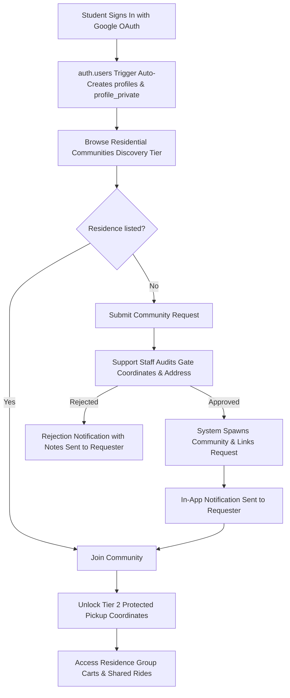
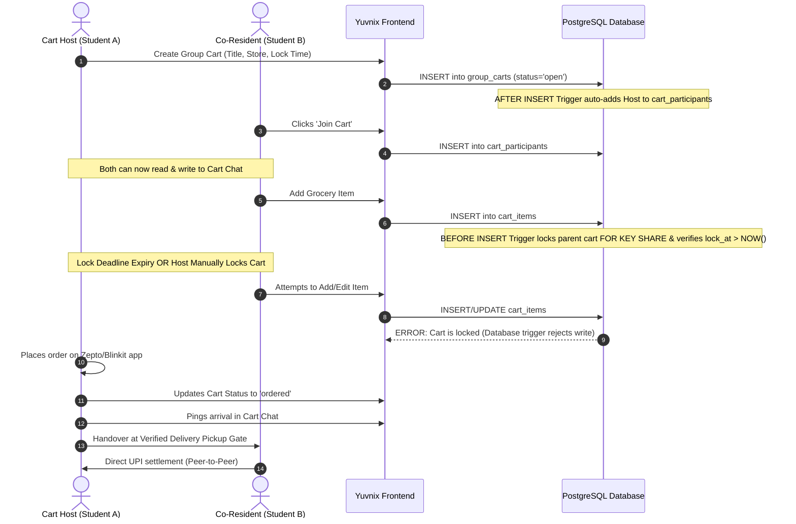
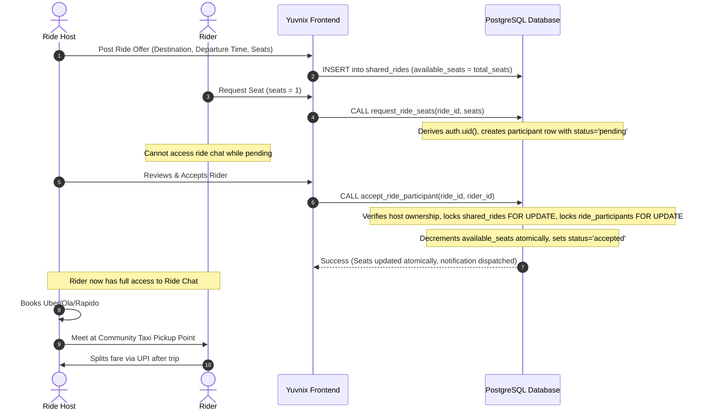

# Yuvnix Product Specification

> **Version:** 3.0.0 (Hardened Pre-Migration Specification)  
> **Tagline:** Your people. Your community.  
> **Target Audience:** College students and young adults living in residential environments (Hostels, Paying Guest accommodations, and shared apartments).  
> **Status:** Specification Document (Certified Architecture v3.0)

---

## 1. Executive Summary

**Yuvnix** is a student-first hyperlocal platform created to solve everyday residential logistical frictions faced by students living away from home. While college campuses serve as educational anchors, the day-to-day survival of students—meals, late-night essentials, groceries, transit, and errands—revolves around their immediate physical living quarters: hostels, PGs, and shared student apartments.

Yuvnix bridges this gap by enabling students in physical residences to:
1. **Connect as verified residential peers** anchored to physical buildings, not abstract college rosters.
2. **Coordinate group grocery delivery orders** (via quick-commerce apps like Zepto, Blinkit, or Instamart) to eliminate duplicate delivery fees and meet order minimums.
3. **Organize shared taxi rides** directly from residential gates to transit hubs (airports, railway stations, bus terminals) and colleges.

---

## 2. Core Product Rules & Governance (Architecture v3.0)

The platform strictly enforces the following foundational product rules:

### Rule 1: Communities represent physical residential locations
Communities are **never** colleges, universities, or academic departments. A community represents a physical, bounded living space—a hostel block, a PG building, or an apartment society.

### Rule 2: Concrete naming conventions
Examples of valid communities:
- `PDEU Hostel` (Boys Wing)
- `PDEU Girls Hostel`
- `Sunrise PG`
- `Friends Apartment`

### Rule 3: College affiliation is optional metadata
A college name (e.g. "PDEU Gandhinagar", "NIFT Gandhinagar") is attached as optional contextual metadata to assist student discovery, but the college is **never** the community entity itself. A single residential PG may house students from multiple colleges.

### Rule 4: Staff-only community approval & request lifecycle
Students cannot directly spawn public communities. Instead, students submit **Community Creation Requests**.
- Only authorized Yuvnix support staff review physical parameters (gates, addresses, security protocols) and approve community creation.
- On approval, the newly created community is linked directly to the original request via `created_community_id`.
- The requesting student receives an in-app notification with a direct link to their newly verified community upon approval or rejection with notes.
- Submissions cannot pre-assign staff IDs or community IDs; requests initialize in a `pending` state under strict database controls.

### Rule 5: Strict non-hierarchical governance & role security
Submitting a community request or being an early member conveys **no permanent administrative authority, ownership, or special privilege** over fellow residents. 
- All students participate on equal footing under democratic community rules.
- **Role Immutability:** Students cannot alter their own account role (`role` remains `student`). Role escalation to `support_staff` or `admin` is rejected at the database trigger layer. Only internal administrative channels can assign elevated roles.

### Rule 6: Two-tier location privacy & verified pickup points
Every approved community has two designated, verified coordinate points:
1. **Shared Delivery Pickup Point**: The exact gate or security desk where delivery riders drop parcels (e.g., *Hostel Gate 1 Security Desk*, *Block G Foyer*).
2. **Shared Taxi Pickup Point**: The designated meetup curb for cab boarding (e.g., *Hostel Circle Gate 1*, *PG Front Parking Bay*).
- **Two-Tier Privacy Model:**
  - **Tier 1 (Public Discovery):** Community Name, Residential Type, Optional College Tag, City, and General Sector are visible to all authenticated students for discovery.
  - **Tier 2 (Protected Member-Only Details):** Exact street address, specific delivery foyer/desk instructions, and taxi curb notes are isolated in `community_pickup_points` and accessible **only** to verified, active residents of that community.

### Rule 7: Multi-community membership
Students are not locked into one group. A student can join multiple communities (e.g., their current PG, their previous college hostel, and an apartment cluster) and participate in activities across all of them.

### Rule 8: Group grocery orders, auto-join, and cart locking
Group grocery carts feature:
- An itemized product wish list.
- An ordering deadline (`lock_at` timestamp).
- **Automatic Creator Participation:** When a host creates a cart, the database transaction automatically records their membership in `cart_participants`, guaranteeing instant access to chat without frontend timing dependencies.
- **Explicit Co-Resident Cart Membership:** Co-residents can join a cart (`cart_participants`) to participate in coordination, notifications, and group chat without being forced to add a product immediately.
- **Race-Condition-Proof Database Locking:** When a cart locks (either when `lock_at` passes or when the host closes the cart), the database trigger locks the parent cart row with `FOR KEY SHARE` to eliminate race conditions between in-flight item additions and cart closure. Once locked, item additions, edits, and deletions are rejected.
- **Dedicated Cart Chat:** Real-time group chat accessible **only** to students who have joined that cart or the verified cart host.
- **Item Permissions:** Students can edit or delete their own added items prior to lock. Cart hosts can remove items before lock.

### Rule 9: Shared taxi rides, atomic reservations, and lifecycle
Shared taxi ride listings feature:
- Explicit departure point (defaults to the community's verified taxi pickup point).
- Explicit destination (e.g., *SVP Airport Terminal 2*, *Kalupur Railway Station*).
- Departure time.
- Total seats and remaining available seats.
- **Two-Step Reservation Lifecycle:**
  1. *Student Request:* A student requests seats via `request_ride_seats()`. Identity is derived securely from `auth.uid()` (client-supplied user IDs are rejected). The record is created with `status = 'pending'`. Available seats are not decremented yet.
  2. *Host Acceptance:* The ride host evaluates the request and invokes `accept_ride_participant()`. The function verifies caller ownership, acquires row-level locks on both the ride and participant rows in a consistent hierarchy, decrements `available_seats` atomically, sets status to `accepted`, and notifies the rider.
- **Anti-Bypass Guarantee:** Students cannot directly update their own participant row to `status = 'accepted'` via table RLS. Direct table mutations are restricted to cancellation.
- **Atomic Cancellation:** Either the rider or the host can invoke `cancel_ride_reservation()`. Rows are locked in a consistent order (`shared_rides` first, then `ride_participants`). If the reservation was previously accepted, seats are returned (`LEAST(total_seats, available_seats + seats_reserved)`). Repeated cancellations are idempotent and cannot cause double seat restoration.
- **Dedicated Ride Chat:** Real-time chat accessible **only** to the ride host and **accepted** ride participants. Students with pending requests cannot read or post messages.

### Rule 10: Peer-to-peer settlement (No payment gateway in MVP)
Students independently decide who orders, who pays the delivery service or cab driver, and how money is collected (via UPI or cash upon delivery). **Yuvnix MVP contains no payment gateway, escrow, or delivery platform API integrations.**

### Rule 11: Free for students
Students are never charged fees, subscriptions, or platform commissions.

### Rule 12: Google OAuth authentication & student profile privacy
- Google OAuth 2.0 is the official authentication method.
- **Automated Profile Provisioning:** An `auth.users` trigger automatically provisions the student's public and private profiles upon OAuth completion, setting `role = 'student'` and initializing data safely.
- **Profile Privacy Separation:**
  - **Public Profile (`profiles`):** Full name, avatar URL, and student role badge. Safe for general authenticated display across communities, carts, and rides.
  - **Private Profile (`profile_private`):** Personal email and phone number. Protected by strict RLS (`auth.uid() = id`). Phone numbers are strictly protected and never returned in general public profile queries.

---

## 3. User Personas

| Persona | Residential Context | Core Need & Behaviors |
| :--- | :--- | :--- |
| **Hostel Fresher** | On-campus hostel block | Ordering late-night snacks after mess closes; finding peers to split airport cabs during semester breaks. |
| **Off-Campus PG Resident** | Private PG 2km from college | Pooling daily groceries with other PG floors; splitting auto/cabs to campus gates. |
| **Apartment Flatmate** | 3BHK flat in private society | Coordinating weekly pantry restocks with neighboring student flats in the same tower. |
| **Yuvnix Support Staff** | Operations & moderation | Auditing community requests, verifying gate pickup spots, and handling platform moderation. |

---

## 4. Operational User Flows (Architecture v3.0)

### 4.1 Onboarding & Community Request Flow

### 4.2 Group Grocery Order Flow & Database Lock

### 4.3 Shared Ride Flow & Atomic Reservation

---

## 5. Notification Specifications & Integrity

Students receive real-time and persistent in-app notifications managed under strict database integrity rules:
1. **Community Request Decision:**
   - *Approved:* `"Your community request for [Residence Name] has been approved! Start by joining and creating group carts."` (Deep link: `/communities/[id]`).
   - *Rejected:* `"Your request for [Residence Name] could not be approved. Reason: [Staff Notes]."`
2. **Cart Events:**
   - *Lock Imminent:* `"Cart [Title] is locking in 15 minutes. Finalize your items."`
   - *Order Placed:* `"Host placed the order! Meet at [Delivery Pickup Point] when delivery arrives."`
3. **Ride Events:**
   - *Seat Requested:* Sent to Host: `"[Rider Name] requested 1 seat for [Destination]."`
   - *Seat Accepted:* Sent to Rider: `"Your seat request for [Destination] was accepted by [Host Name]. You can now coordinate in ride chat."`
   - *Seat Declined / Cancelled:* Immediate status update dispatched to affected parties.
4. **Notification Integrity Rules:**
   - Notifications are created exclusively by trusted database functions running with `SECURITY DEFINER`.
   - Students can only mark their own notifications as read (`is_read = true`).
   - Direct mutations of notification title, body, recipient, or link URL are blocked at the database engine level.

---

## 6. MVP Non-Goals & Boundaries

1. **No In-App Payment Processing:** No payment gateway, wallet, escrow, or split-bill calculator in MVP.
2. **No Quick-Commerce API Integrations:** Orders are placed by students on their existing consumer apps.
3. **No Native Turn-by-Turn GPS Tracking:** Standard cab apps (Uber/Ola/Rapido) handle road navigation.
4. **No Student Hierarchy:** No "Hostel President" or student moderator tier that restricts peer access.
