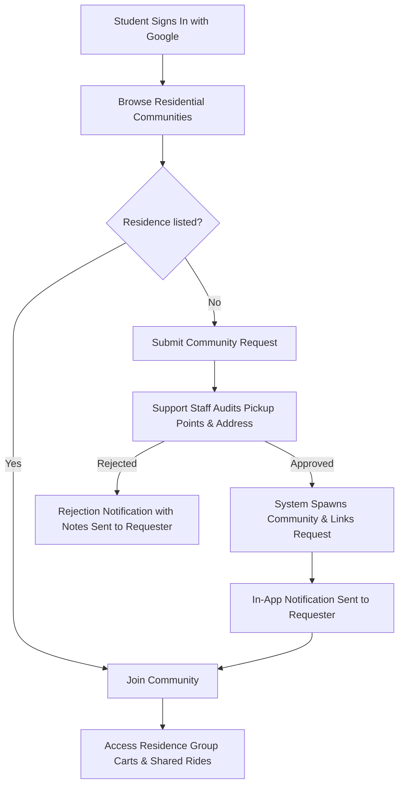
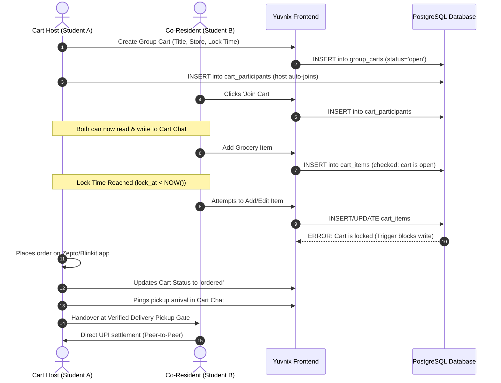
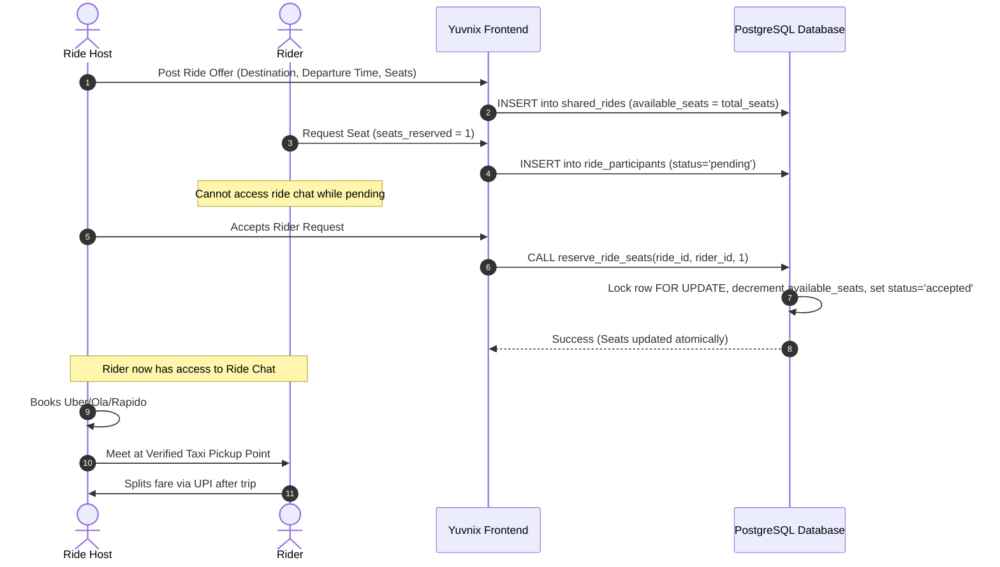

# Yuvnix Product Specification

> **Tagline:** Your people. Your community.  
> **Target Audience:** College students and young adults living in residential environments (Hostels, Paying Guest accommodations, and shared apartments).  
> **Status:** MVP Product Specification (Updated Post-Architecture Review)

---

## 1. Executive Summary

**Yuvnix** is a student-first hyperlocal platform created to solve everyday residential logistical frictions faced by students living away from home. While college campuses serve as educational anchors, the day-to-day survival of students—meals, late-night essentials, groceries, transit, and errands—revolves around their immediate physical living quarters: hostels, PGs, and shared student apartments.

Yuvnix bridges this gap by enabling students in physical residences to:
1. **Connect as verified residential peers** anchored to physical buildings, not abstract college rosters.
2. **Coordinate group grocery delivery orders** (via quick-commerce apps like Zepto, Blinkit, or Instamart) to eliminate duplicate delivery fees and meet order minimums.
3. **Organize shared taxi rides** directly from residential gates to transit hubs (airports, railway stations, bus terminals) and colleges.

---

## 2. Core Product Rules & Governance

The platform strictly enforces the following foundational product rules:

### Rule 1: Communities represent physical residential locations
Communities are **never** colleges, universities, or academic departments. A community represents a physical, bounded living space—a hostel block, a PG building, or an apartment society.

### Rule 2: Concrete naming conventions
Examples of valid communities:
- `PDEU Hostel` (Boys Wing)
- `PDEU Girls Hostel`
- `Sunrise PG`
- `Friends Apartment`

### Rule 3: College affiliation is optional metadata
A college name (e.g. "PDEU Gandhinagar", "NIFT Gandhinagar") is attached as optional contextual metadata to assist student discovery, but the college is **never** the community entity itself. A single residential PG may house students from multiple colleges.

### Rule 4: Staff-only community approval & request lifecycle
Students cannot directly spawn public communities. Instead, students submit **Community Creation Requests**.
- Only authorized Yuvnix support staff review physical parameters (gates, addresses, security protocols) and approve community creation.
- On approval, the newly created community is linked directly to the original request via `created_community_id`.
- The requesting student receives an in-app notification with a direct link to their newly verified community upon approval or rejection with notes.

### Rule 5: Strict non-hierarchical governance
Submitting a community request or being an early member conveys **no permanent administrative authority, ownership, or special privilege** over fellow residents. All residents participate on equal footing under democratic community rules. Only Yuvnix support staff possess moderation and administrative authority.

### Rule 6: Verified pickup points & location privacy
Every approved community has two designated, verified coordinate points:
1. **Shared Delivery Pickup Point**: The exact gate or security desk where delivery riders drop parcels (e.g., *Hostel Gate 1 Security Desk*, *Block G Foyer*).
2. **Shared Taxi Pickup Point**: The designated meetup curb for cab boarding (e.g., *Hostel Circle Gate 1*, *PG Front Parking Bay*).
*Privacy Control:* General pickup landmarks are visible for discovery, but granular gate access notes and internal delivery instructions are restricted to authenticated members of that residence.

### Rule 7: Multi-community membership
Students are not locked into one group. A student can join multiple communities (e.g., their current PG, their previous college hostel, and a friend's apartment cluster) and participate in activities across all of them.

### Rule 8: Group grocery orders & cart lifecycle
Group grocery carts feature:
- An itemized product wish list.
- An ordering deadline (`lock_at` timestamp).
- **Explicit Cart Membership:** Students can join a cart (`cart_participants`) to participate in coordination, notifications, and group chat without being forced to add a product immediately.
- **Strict Database-Enforced Locking:** Once a cart locks (`lock_at` passes or host marks status as `locked`), no items can be added, modified, or removed. This lock is enforced at the PostgreSQL layer, preventing client-side bypass.
- **Dedicated Cart Chat:** Real-time group chat accessible **only** to students who have joined that cart.
- **Item Permissions:** Students can edit or delete their own added items prior to lock. Cart hosts can manage the cart status and remove items before lock.

### Rule 9: Shared taxi rides & seat reservation lifecycle
Shared taxi ride listings feature:
- Explicit departure point (defaults to the verified taxi pickup point).
- Explicit destination (e.g., *SVP Airport Terminal 2*, *Kalupur Railway Station*).
- Departure time.
- Total seats and remaining available seats.
- **Seat Request States:** `pending` → `accepted` / `declined` / `cancelled`.
- **Atomic Concurrency Protection:** Seat reservations use atomic row-locking database transactions to ensure available seats never become negative or overbooked.
- **Dedicated Ride Chat:** Real-time chat accessible **only** to the ride host and **accepted** ride participants. Students with pending requests cannot read or post messages.

### Rule 10: Peer-to-peer settlement (No payment gateway in MVP)
Students independently decide who orders, who pays the delivery service or cab driver, and how money is collected (via UPI or cash upon delivery). **Yuvnix MVP contains no payment gateway, escrow, or delivery platform API integrations.**

### Rule 11: Free for students
Students are never charged fees, subscriptions, or platform commissions.

### Rule 12: Google OAuth authentication & student profile privacy
- Google OAuth 2.0 is the official authentication method.
- **Profile Privacy Separation:**
  - **Public Profile:** Full name, avatar URL, and student badge. Safe for general authenticated display across communities, carts, and rides.
  - **Private Profile:** Personal email and phone number. Phone numbers are strictly protected and never returned in general profile queries.

---

## 3. User Personas

| Persona | Residential Context | Core Need & Behaviors |
| :--- | :--- | :--- |
| **Hostel Fresher** | On-campus hostel block | Ordering late-night snacks after mess closes; finding peers to split airport cabs during semester breaks. |
| **Off-Campus PG Resident** | Private PG 2km from college | Pooling daily groceries with other PG floors; splitting auto/cabs to campus gates. |
| **Apartment Flatmate** | 3BHK flat in private society | Coordinating weekly pantry restocks with neighboring student flats in the same tower. |
| **Yuvnix Support Staff** | Operations & moderation | Auditing community requests, verifying gate pickup spots, and handling platform moderation. |

---

## 4. Operational User Flows

### 4.1 Onboarding & Community Request Flow

### 4.2 Group Grocery Order Flow & Database Lock

### 4.3 Shared Ride Flow & Atomic Reservation

---

## 5. Notification Specifications

Students receive real-time and persistent in-app notifications for:
1. **Community Request Decision:**
   - *Approved:* `"Your community request for [Residence Name] has been approved! Start by joining and creating group carts."` (Links directly to `/communities/[slug]`).
   - *Rejected:* `"Your request for [Residence Name] could not be approved. Reason: [Staff Notes]."`
2. **Cart Events:**
   - *Lock Imminent:* `"Cart [Title] is locking in 15 minutes. Finalize your items."`
   - *Order Placed:* `"Host placed the order! Meet at [Delivery Pickup Point] when delivery arrives."`
3. **Ride Events:**
   - *Seat Accepted:* `"Your seat request for [Destination] was accepted by [Host Name]. You can now coordinate in ride chat."`
   - *Ride Full / Departed:* Status updates for confirmed riders.

---

## 6. MVP Non-Goals & Boundaries

1. **No In-App Payment Processing:** No payment gateway, wallet, escrow, or split-bill calculator in MVP.
2. **No Quick-Commerce API Integrations:** Orders are placed by students on their existing consumer apps.
3. **No Native Turn-by-Turn GPS Tracking:** Standard cab apps (Uber/Ola/Rapido) handle road navigation.
4. **No Student Hierarchy:** No "Hostel President" or student moderator tier that restricts peer access.
