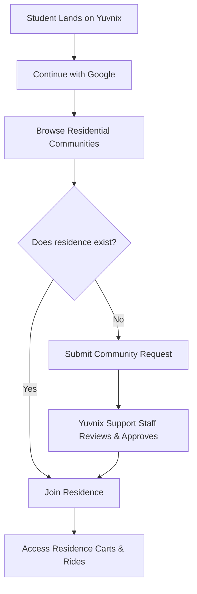
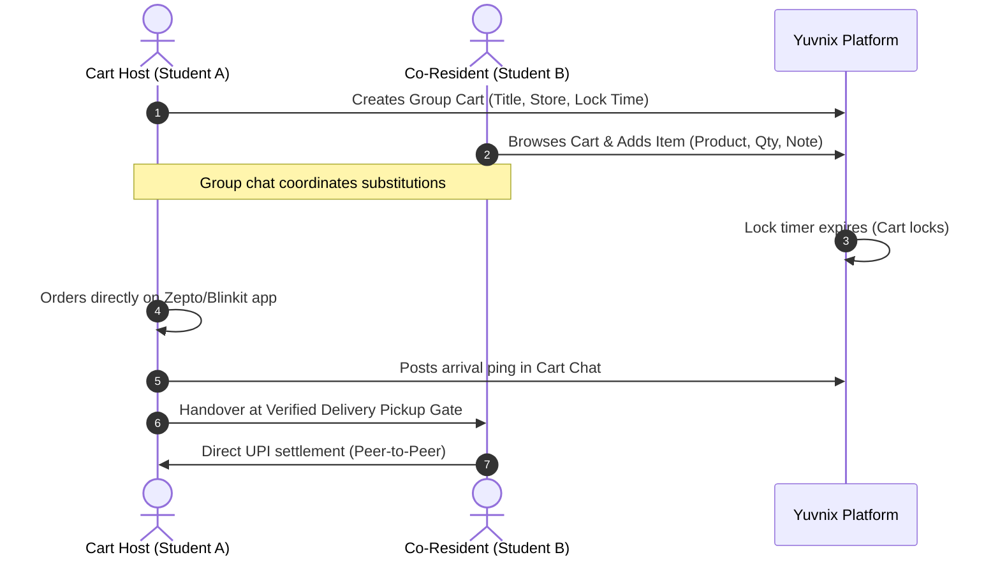
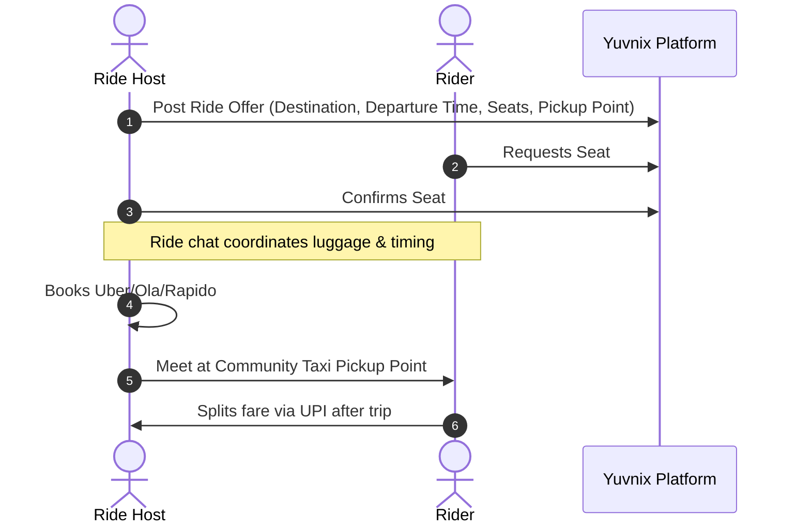

# Yuvnix Product Specification

> **Tagline:** Your people. Your community.  
> **Target Audience:** College students and young adults living in residential living spaces (Hostels, Paying Guest accommodations, and shared apartments).  
> **Status:** MVP Foundation Specification

---

## 1. Executive Summary

**Yuvnix** is a student-first hyperlocal platform created to solve everyday residential logistical frictions faced by students living away from home. While college campuses serve as educational anchors, the day-to-day survival of students—meals, late-night essentials, groceries, transit, and errands—revolves around their immediate physical living quarters: hostels, PGs, and shared student apartments.

Yuvnix bridges this gap by enabling students in physical residences to:
1. **Connect as verified residential peers** anchored to physical buildings, not abstract college rosters.
2. **Coordinate group grocery delivery orders** (via quick-commerce apps like Zepto, Blinkit, or Instamart) to eliminate duplicate delivery fees and meet order minimums.
3. **Organize shared taxi rides** directly from residential gates to transit hubs (airports, railway stations, bus terminals) and colleges.

---

## 2. Core Product Rules & Constraints

The system design strictly enforces the following 12 foundational rules:

### Rule 1: Communities represent physical residential locations
Communities are **never** colleges or academic institutions. A community represents a physical, bounded living space—a hostel block, a PG building, or an apartment society.

### Rule 2: Concrete naming conventions
Examples of valid communities:
- `PDEU Hostel` (Boys Wing)
- `PDEU Girls Hostel`
- `Sunrise PG`
- `Friends Apartment`

### Rule 3: College affiliation is optional metadata
A college name (e.g. "PDEU Gandhinagar", "NIFT Gandhinagar") is attached as optional contextual metadata to assist student discovery, but the college is **never** the community entity itself. A single residential PG may house students from multiple colleges.

### Rule 4: Staff-only community approval workflow
Students cannot directly spawn public communities. Instead, students submit **Community Creation Requests**. Only authorized Yuvnix support staff review physical parameters (gates, addresses, security protocols) and approve community creation.

### Rule 5: Strict non-hierarchical governance
Submitting a community request or being an early member conveys **no permanent administrative authority, ownership, or special privilege** over fellow residents. All residents participate on equal footing.

### Rule 6: Verified pickup points
Every community has two designated, verified coordinate points:
1. **Shared Delivery Pickup Point**: The exact gate or security desk where delivery riders drop parcels (e.g., *Hostel Gate 1 Security Desk*, *Block G Foyer*).
2. **Shared Taxi Pickup Point**: The designated meetup curb for cab boarding (e.g., *Hostel Circle Gate 1*, *PG Front Parking Bay*).

### Rule 7: Multi-community membership
Students are not locked into one group. A student can join multiple communities (e.g., their current PG, their previous college hostel, and an apartment cluster).

### Rule 8: Group grocery orders
Group grocery carts feature:
- An itemized product wish list.
- An ordering deadline ("lock timer").
- A private real-time group chat for coordinating additions, out-of-stock substitutions, and delivery notifications.

### Rule 9: Shared taxi rides
Ride listings feature:
- Explicit departure point (defaults to the verified taxi pickup point).
- Explicit destination (e.g., *SVP Airport Terminal 2*, *Kalupur Railway Station*).
- Departure time.
- Total seats and remaining available seats.
- Dedicated ride-specific group chat.

### Rule 10: Peer-to-peer settlement (No payment gateway in MVP)
Students independently decide who orders, who pays the delivery service or cab driver, and how money is collected (via UPI / cash upon delivery). **Yuvnix MVP contains no payment gateway or delivery platform integration.**

### Rule 11: Free for students
Students are never charged fees, subscriptions, or commissions for using the platform.

### Rule 12: Google OAuth authentication
Google OAuth 2.0 is the official, streamlined authentication method, allowing fast one-tap onboarding using personal or university Google accounts.

---

## 3. User Personas

| Persona | Residential Context | Core Need |
| :--- | :--- | :--- |
| **Hostel Fresher** | On-campus hostel block | Ordering late-night snacks after mess closes; finding seniors or classmates to split airport cabs during semester breaks. |
| **Off-Campus PG Resident** | Private PG 2km from college | Pooling daily milk and fruit deliveries with other PG floors; splitting auto/cabs to campus. |
| **Apartment Flatmate** | 3BHK flat in private society | Coordinating weekly pantry restocks with neighboring student flats in the same tower. |
| **Yuvnix Support Staff** | Central operations | Auditing community creation requests, verifying physical pickup points, maintaining platform hygiene. |

---

## 4. MVP User Flows

### 4.1 Onboarding & Community Discovery

### 4.2 Group Grocery Order Flow

### 4.3 Shared Ride Flow

---

## 5. Non-Goals for MVP

1. **No In-App Payment Processing:** No Razorpay, Stripe, or wallet holding funds.
2. **No Direct Delivery API Integration:** No automated order dispatch to Zepto, Blinkit, or Swiggy Instamart APIs.
3. **No Turn-by-Turn Navigation:** No real-time driver GPS tracking (standard Uber/Ola apps handle transit navigation).
4. **No Student Hierarchy:** No "Hostel President" or student admin roles that restrict other students.
